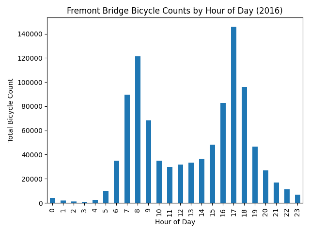

# HW1: Python Data Analysis Basics

## Process
I followed the questions in order and worked through them one step at a time. I used Claude to guide me through each step and explain the pandas syntax, and I ran and checked the output myself after every step. Along the way I found that the date format in the data was different from the hint, and that the only missing hour in 2016 was caused by the start of daylight saving time.

## Results
The only missing time point in 2016 was 2016-03-13 02:00, and the busiest hour of the day on average was 17 (5-6 PM), with about 399 bicycles per hour.

## Bonus
I converted the whole `Date` column to pandas' datetime format with `pd.to_datetime`. Python's `datetime.datetime` stores each timestamp as a separate object, which is slow for large data. NumPy's `datetime64` stores timestamps as fixed-size integers, so it is fast for array operations.